<p align="center">
  <picture>
    <source media="(prefers-color-scheme: dark)" srcset="branding/logo/logo-horizontal-on-dark.svg">
    
  </picture>
</p>

<h3 align="center">Tus servidores SFTP, FTP, FTPS y WebDAV, y tu almacenamiento en S3, Google y Azure, en el navegador, con un equipo, un vault cifrado y transferencias que no se pierden.</h3>

<p align="center">
  <a href="LICENSE"></a>
  
  
  
  
</p>

<p align="center">
  <a href="#inicio-rápido"><b>Inicio rápido</b></a> ·
  <a href="#características"><b>Características</b></a> ·
  <a href="#galería"><b>Galería</b></a> ·
  <a href="#lo-que-viene"><b>Lo que viene</b></a> ·
  <a href="docs/ROADMAP.md"><b>Roadmap</b></a>
</p>

<p align="center">
  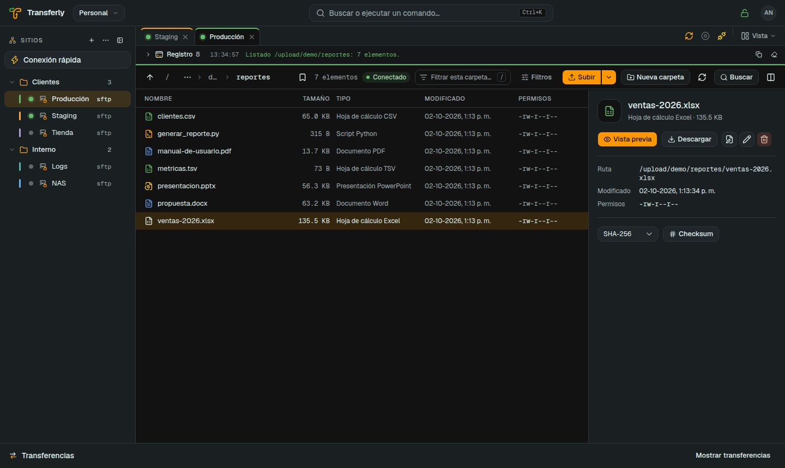
</p>

---

**Transferly** es un cliente de transferencia de archivos que vive en tu propio servidor. Todo lo que hacías con FileZilla o WinSCP (sitios guardados, doble panel, cola de transferencias, reanudación, registro de la conexión) ahora funciona desde cualquier navegador, y no solo con servidores SFTP, FTP o WebDAV: también con buckets de S3, Google Cloud Storage, Google Drive y Azure Storage. Sin instalar nada en cada equipo y sin que las contraseñas de tus servidores salgan del vault.

Está pensado para equipos: cada persona tiene su cuenta y su espacio personal, y los workspaces de equipo comparten sitios con roles, invitaciones y auditoría. Las credenciales se cifran con una contraseña maestra que el servidor nunca guarda.

## Índice

- [¿Por qué Transferly?](#por-qué-transferly)
- [Inicio rápido](#inicio-rápido)
- [Características](#características)
  - [Explorador y transferencias](#explorador-y-transferencias)
  - [Servidores, nubes y formas de conectarse](#servidores-nubes-y-formas-de-conectarse)
  - [Visor de archivos sin descargar](#visor-de-archivos-sin-descargar)
  - [Seguridad](#seguridad)
  - [Equipos y administración](#equipos-y-administración)
  - [Una interfaz cómoda](#una-interfaz-cómoda)
- [Rendimiento medido](#rendimiento-medido)
- [Galería](#galería)
- [Lo que viene](#lo-que-viene)
- [Configuración](#configuración)
- [Cómo está hecho](#cómo-está-hecho)
- [Desarrollo](#desarrollo)
- [Documentación](#documentación)
- [Licencia](#licencia)

## ¿Por qué Transferly?

| | Cliente de escritorio clásico | **Transferly** |
|---|---|---|
| Dónde se usa | En cada equipo donde se instaló | En cualquier navegador, también en el teléfono |
| Contraseñas de los servidores | En un archivo del equipo | En un vault cifrado con Argon2id y AES-256-GCM |
| Trabajo en equipo | Cada uno con su lista de sitios | Workspaces compartidos con roles, invitaciones y auditoría |
| Acceso a la red interna | Directo desde el equipo | Lo controla el servidor con una política de redes permitidas |
| Ver un archivo | Descargarlo y abrirlo | Vista previa en el navegador, sin descargar |
| Un corte de red | La transferencia empieza de nuevo | Se reanuda donde quedó |

## Inicio rápido

Solo necesitas Docker con Compose v2 y git.

```sh
git clone https://github.com/fprambs/transferly.git
cd transferly
docker compose up -d
```

Abre **http://localhost:8080**. El asistente del primer arranque crea la cuenta de administración. Después configuras el vault con tu contraseña maestra y guardas tu primer sitio.

Para publicarlo con HTTPS y certificados automáticos:

```sh
TRANSFERLY_DOMAIN=transferly.tuempresa.com TRANSFERLY_BASE_URL=https://transferly.tuempresa.com docker compose --profile https up -d --build
```

La imagen corre sin privilegios, con el sistema de archivos de solo lectura y sin capacidades del kernel.

## Características

### Explorador y transferencias

- **Pestañas de conexión**: varias conexiones abiertas a la vez. Cada una recuerda su carpeta, su selección y su vista dividida.
- **Doble panel** con arrastrar y soltar: copia archivos y carpetas entre dos servidores, o entre un servidor y una carpeta de tu equipo.
- **Cola de transferencias** con prioridades, pausa, reanudación y cancelación. Hay límites globales, por workspace, por persona y por sitio.
- **Transferencias que se reanudan** tras un corte, en SFTP, FTP, Google Drive y Azure Files. Las subidas son atómicas: en los servidores se escriben como `.part` y se renombran al terminar, y en S3, Cloud Storage y Azure Blob el objeto aparece entero o no aparece.
- **Carpetas completas**: súbelas desde el navegador, descárgalas como ZIP en streaming o archivo por archivo, y cópialas entre sitios con una política para los archivos que ya existen.
- **Comparar y sincronizar carpetas** (local con remota o remota con remota), con una simulación antes de tocar nada.
- **Búsqueda recursiva** en el servidor y un **filtro instantáneo** sobre la carpeta en vista: comodines, tipos, fechas y tamaños.
- **Editor remoto** con resaltado de sintaxis y detección de conflictos antes de guardar.
- **Marcadores** por sitio, **checksums** (MD5, SHA-1, SHA-256, SHA-512) y un **registro de la conexión en vivo**, paso a paso y sin secretos.
- **Importación desde FileZilla**: trae tu `sitemanager.xml` con sus carpetas y, si quieres, sus contraseñas, que van directo al vault.

### Servidores, nubes y formas de conectarse

Cada tipo de sitio es un **conector** del catálogo. Un sitio nuevo empieza eligiendo su servicio en un catálogo con el ícono de cada uno, y el formulario se arma a partir del esquema del conector. Un administrador decide qué conectores ofrece la instancia; los nuevos llegan en beta y apagados.

- **SFTP**: contraseña, archivo de clave (OpenSSH, PEM y PuTTY `.ppk`), anónimo, interactivo (por ejemplo un código de un solo uso) o contraseña pedida al conectar.
- **FTP y FTPS**: TLS explícito o implícito, o solo FTP plano. Admite el comando ACCT, el juego de caracteres configurable por sitio y la zona horaria de `LIST` detectada automáticamente.
- **Modo sudo** por sitio: navega y edita como root, u otro usuario, en servidores donde la cuenta puede usar sudo. Solo un administrador lo activa.
- **Herramientas SSH** en servidores SFTP que permiten comandos: copiar dentro del servidor, comprimir en ZIP o tar.gz, extraer, calcular checksums y medir carpetas los hace el propio servidor, sin que los datos pasen por Transferly.
- **Terminal integrada** en servidores SFTP con shell: abre una consola en la carpeta que estás viendo, en pestañas debajo de los archivos, sobre la misma conexión SSH. Solo un administrador la activa por sitio y la abre, y queda registrada en la actividad.
- **Saltos y proxies**: ProxyJump por SSH y proxies SOCKS5 o HTTP. Cada salto pasa por la política de red.
- **Claves de servidor**: confianza en el primer uso, aviso si la clave cambia y soporte para servidores con varias claves detrás de un balanceador.
- **WebDAV** (beta): Nextcloud, ownCloud, NAS y cualquier servidor WebDAV, con carpetas reales y la ruta raíz de cada sitio. Un certificado autofirmado se acepta confirmando su huella, como en FTPS.
- **S3 y compatibles** (beta): Amazon S3, MinIO, Cloudflare R2, Wasabi y otros, con claves de acceso, endpoint propio y carpetas emuladas con prefijos.
- **Google Cloud Storage** (beta): buckets con una clave HMAC.
- **Google Drive** (beta): Mi unidad o una unidad compartida, con inicio de sesión con Google en una ventana emergente. Los documentos de Google se descargan como Word, Excel, PowerPoint o PDF, y lo borrado va a la papelera.
- **Azure Blob Storage** (beta): contenedores con la clave de la cuenta, un token SAS o acceso público, también en nubes soberanas.
- **Azure Files** (beta): recursos compartidos con carpetas reales, renombres nativos y subidas reanudables.
- **Conexión rápida** para probar un servidor sin guardarlo. Si funciona, se guarda como sitio con un clic.

### Visor de archivos sin descargar

Abre cualquier archivo con la barra espaciadora y recorre la carpeta con las flechas, como en Quick Look. Los archivos se leen por rangos: nunca se trae el archivo entero solo para mostrar el principio.

- Texto y código con resaltado, Markdown, JSON, YAML y XML en árbol, CSV y TSV como tabla.
- Imágenes (incluidas TIFF, AVIF y SVG sin scripts) con zoom, rotación y datos EXIF.
- PDF con páginas, miniaturas y búsqueda, sin ejecutar el JavaScript del documento.
- Audio y video.
- Comprimidos (zip, tar, gz, 7z, rar y más) como árbol navegable, leído en el servidor y con protección contra bombas de descompresión.
- Documentos de Word y OpenDocument, planillas de Excel y diapositivas de PowerPoint.
- Bases SQLite, certificados, claves públicas y correos `.eml`.

Todo lo que puede ser peligroso se dibuja en una página aislada: origen opaco, sin cookies, sin acceso a la API y sin red.

### Seguridad

- **Vault cifrado** por persona: Argon2id para derivar la clave y AES-256-GCM para los secretos, con kit de recuperación y bloqueo por inactividad. El servidor nunca guarda la contraseña maestra.
- **Claves por workspace** con X25519. Se rotan automáticamente cuando alguien deja el equipo.
- **Segundo factor**: app de autenticación (TOTP), **passkeys** (WebAuthn) y códigos de recuperación.
- **Política de red** contra SSRF y DNS rebinding: los servidores en redes privadas solo se alcanzan si un administrador lo permite.
- Sesiones opacas, CSRF firmado, límites de intentos y WebSocket con origen validado.
- **Exportación cifrada** de los sitios con su propia contraseña.
- Cada fase del proyecto cierra con una [revisión de seguridad](docs/security/README.md) publicada.

### Equipos y administración

- **Workspaces de equipo** con roles (propietario, administrador, editor, lector), invitaciones de un solo uso y transferencia de propiedad.
- **Registro de auditoría** del equipo y de la instancia: miembros, invitaciones, sitios, claves y servidores de confianza.
- **Panel de administración**: cuentas, roles, deshabilitar accesos, quitar un segundo factor perdido, redes permitidas, límites y los conectores que ofrece la instancia. Todo se edita en caliente.
- **Cuotas y límites**: ancho de banda global y por persona, transferencias simultáneas, sitios, equipos, miembros y volumen diario.
- **Registro de actividad** privado por persona, con retención configurable.

### Una interfaz cómoda

- **Paleta de comandos** (`Ctrl+K` o `⌘K`) para abrir sitios, pestañas y marcadores, ejecutar acciones e ir a la configuración.
- **Atajos de teclado** en todo el explorador. Pulsa `?` para verlos.
- **Inicio** con los sitios recientes y una guía de primeros pasos.
- **12 temas**: Transferly oscuro y claro, Monokai, Dracula, Nord, Solarized, One Dark, Tokyo Night, Gruvbox y GitHub. Guardados en tu cuenta.
- **Etiquetas de color** por sitio, visibles en la barra, las pestañas y el explorador, para no confundir producción con staging.
- **Paneles redimensionables** y un diseño que se adapta a pantallas angostas.
- **Español e inglés**, con la estructura lista para que la comunidad sume idiomas.
- **Mensajes de error guiados**: cada error dice su causa probable y qué hacer.
- **Accesible**: navegable con teclado, compatible con lectores de pantalla y con contraste WCAG AA en todos los temas.

## Rendimiento medido

Una instancia en Docker, con la API de Transferly y un servidor SFTP en la misma máquina. Medición del 27 de noviembre de 2026, con **318 operaciones correctas** en los lotes medidos.

| Operación | Solicitudes simultáneas | p50 | p95 | Tasa agregada |
|---|---:|---:|---:|---:|
| Abrir conexión SFTP, listar y cerrar | 1 | 77,52 ms | 112,54 ms | 12,19 op/s |
| Abrir conexión SFTP, listar y cerrar | 2 | 80,51 ms | 97,45 ms | 23,43 op/s |
| Abrir conexión SFTP, listar y cerrar | 4 | 87,27 ms | 110,72 ms | 37,73 op/s |
| Listar con la conexión reutilizada | 1 | 8,47 ms | 9,88 ms | 115,03 op/s |
| Listar con la conexión reutilizada | 4 | 10,24 ms | 12,26 ms | 244,76 op/s |
| Listar con la conexión reutilizada | 8 | 14,28 ms | 30,34 ms | 446,76 op/s |
| Descargar y verificar 16 MiB | 1 | 296,89 ms | 316,81 ms | 53,76 MiB/s |
| Descargar y verificar 16 MiB | 4 | 531,82 ms | 588,59 ms | 114,19 MiB/s |
| Descargar y verificar 16 MiB | 8 | 1.025,19 ms | 1.191,51 ms | 117,29 MiB/s |

En esta ejecución, cuatro descargas simultáneas duplicaron la tasa agregada frente a una. Con ocho, la tasa apenas aumentó y el p95 casi se duplicó respecto de cuatro. La tabla describe una carga local de un usuario y un servidor SFTP.

Reproduce la prueba con `./scripts/bench-connections.sh > connections.json`. Consulta la [metodología y el entorno](docs/benchmarks/sftp-http.md) y los [datos por solicitud](docs/benchmarks/sftp-http-2026-11-27.json).

## Galería

<table>
  <tr>
    <td width="50%">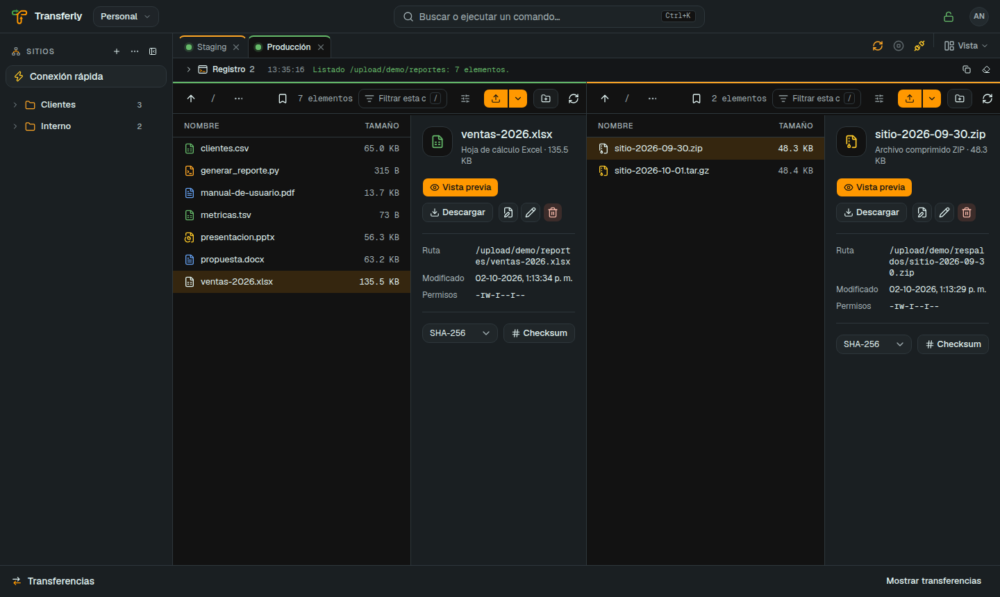<br><sub><b>Doble panel</b> entre Producción y Staging, cada uno con su carpeta.</sub></td>
    <td width="50%">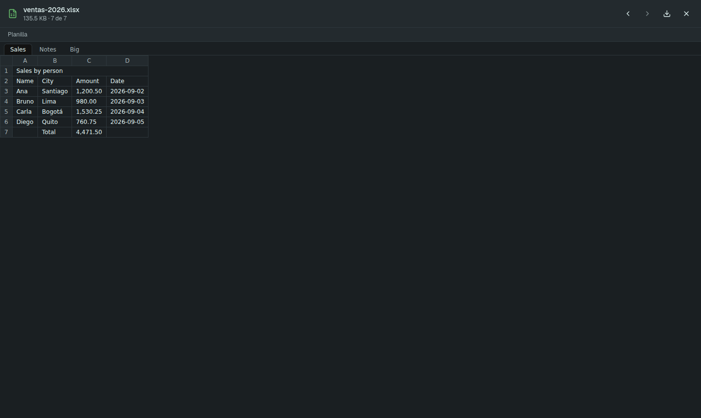<br><sub><b>Vista previa</b> de una planilla de Excel, sin descargarla.</sub></td>
  </tr>
  <tr>
    <td>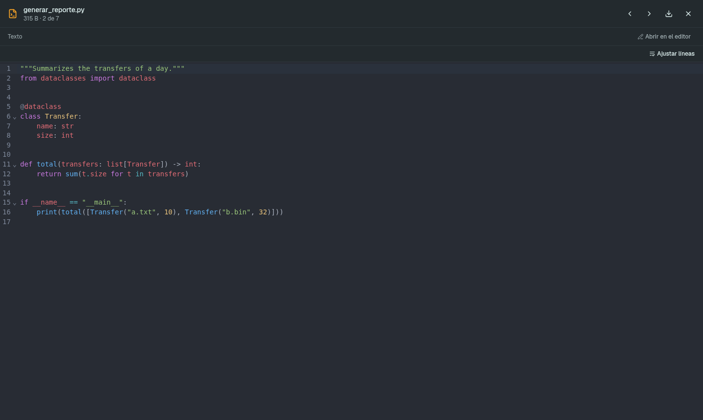<br><sub><b>Código con resaltado</b> y un botón para editarlo en el servidor.</sub></td>
    <td>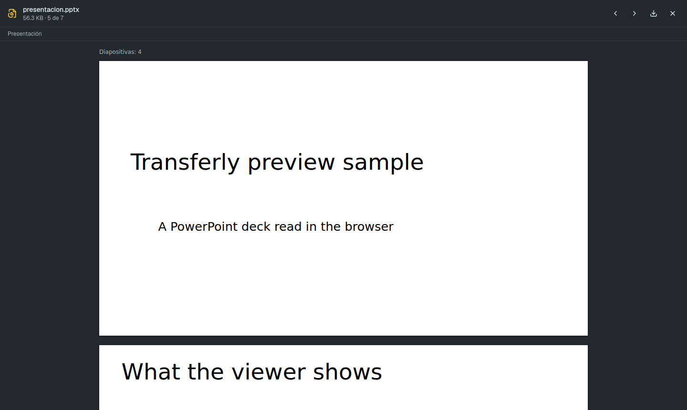<br><sub><b>Diapositivas</b> de PowerPoint en el navegador.</sub></td>
  </tr>
  <tr>
    <td>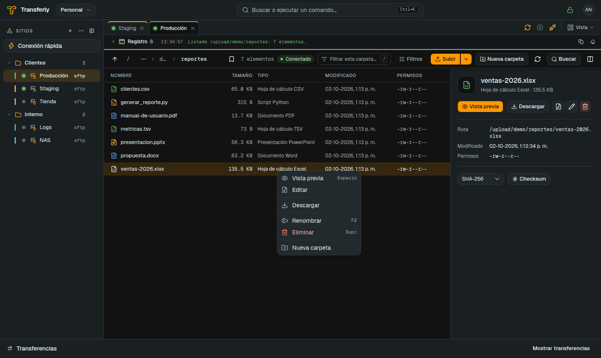<br><sub><b>Menú contextual</b> con íconos y atajos.</sub></td>
    <td>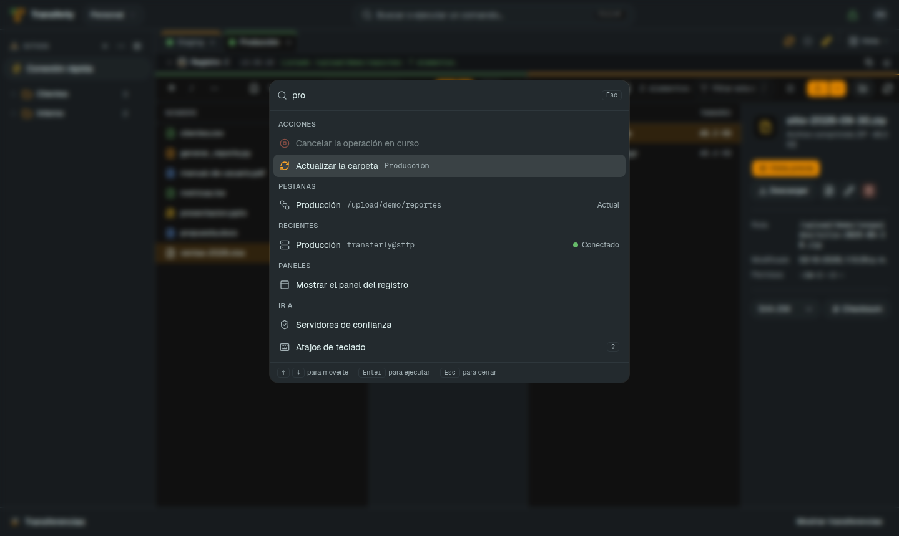<br><sub><b>Paleta de comandos</b> con sitios recientes, pestañas y acciones.</sub></td>
  </tr>
  <tr>
    <td>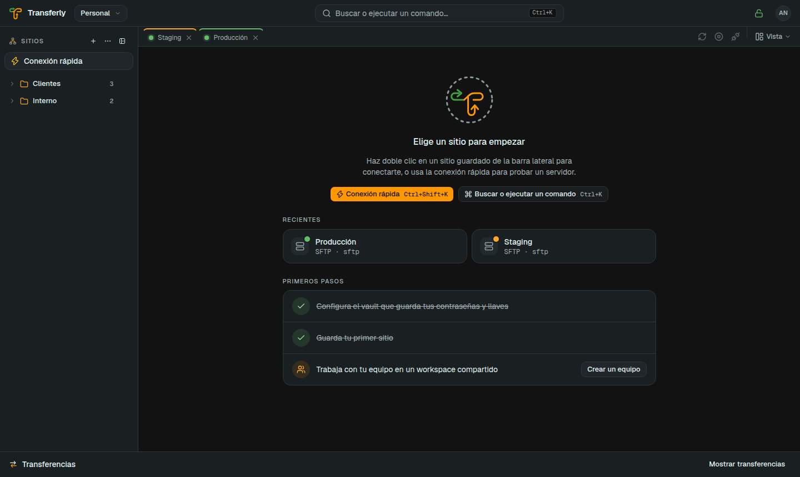<br><sub><b>Inicio</b> con sitios recientes y primeros pasos.</sub></td>
    <td>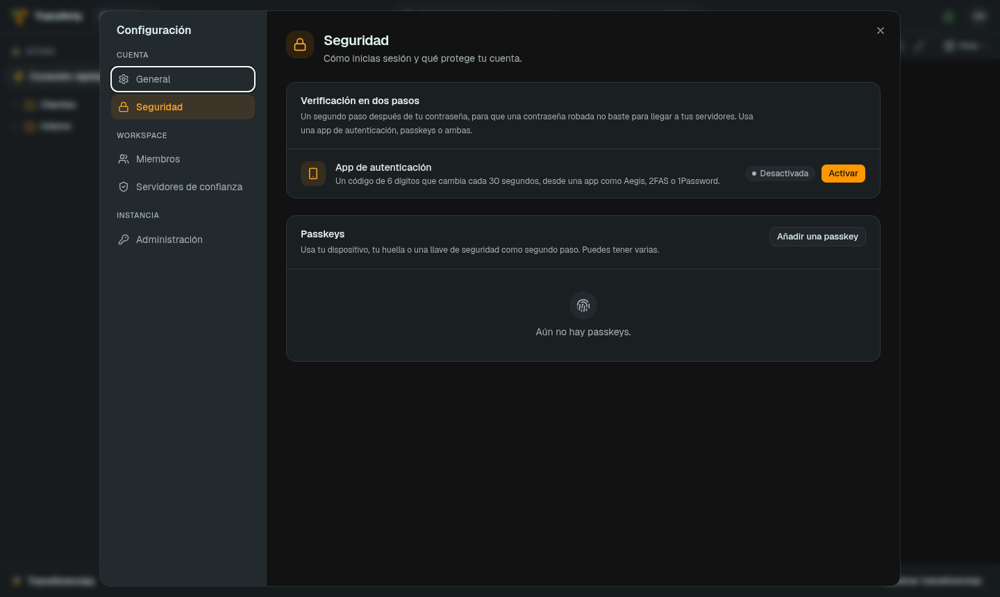<br><sub><b>Configuración</b> en un diálogo: seguridad, miembros, servidores de confianza y administración.</sub></td>
  </tr>
  <tr>
    <td>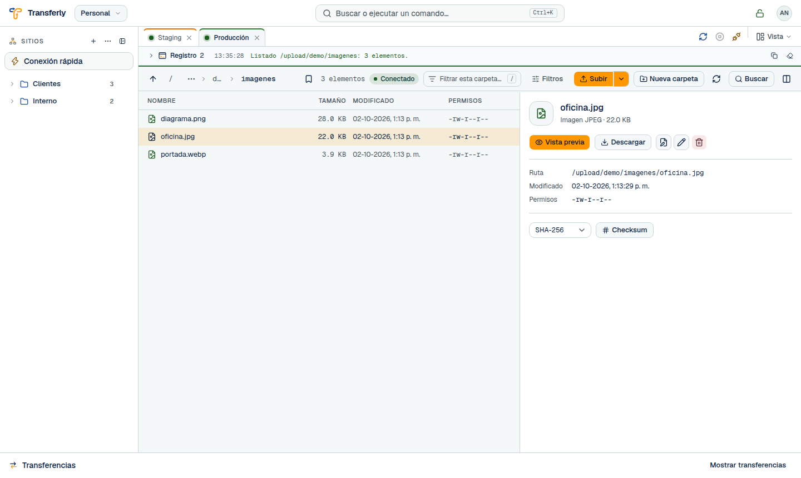<br><sub><b>Tema claro</b>, uno de los 12 temas.</sub></td>
    <td>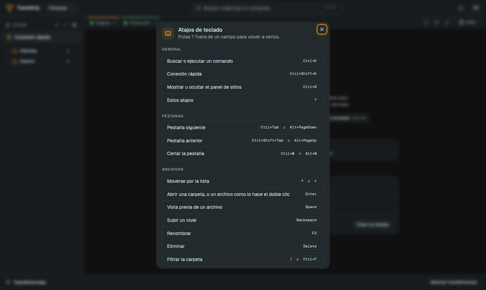<br><sub><b>Atajos de teclado</b> a un <code>?</code> de distancia.</sub></td>
  </tr>
  <tr>
    <td>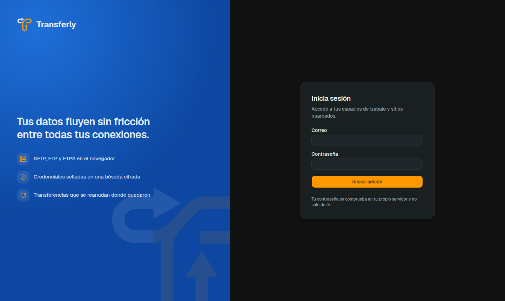<br><sub><b>Inicio de sesión</b>, con segundo factor y passkeys si los activas.</sub></td>
    <td align="center">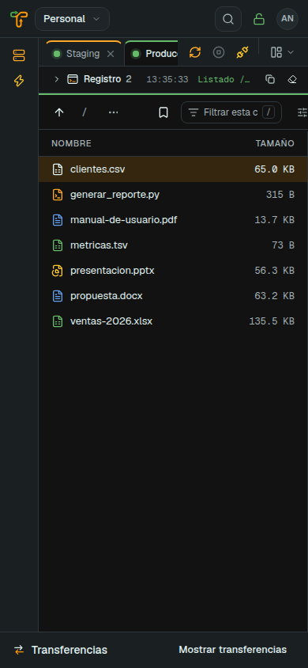<br><sub><b>En el teléfono</b>: los sitios en un panel deslizable.</sub></td>
  </tr>
</table>

## Lo que viene

Ya están terminadas las fases 0 a 4 del [roadmap](docs/ROADMAP.md): MVP, el núcleo tipo FileZilla, equipos multiusuario, funciones avanzadas y el visor de archivos. De la fase 5 ya están el catálogo de conectores y los conectores de S3, Google (Cloud Storage y Drive), Azure (Blob Storage y Files) y WebDAV. Esto es lo próximo:

**Fase 5: escala e integraciones**

- ☁️ **Más destinos**: SMB, y OneDrive y SharePoint con inicio de sesión de Microsoft.
- 🔑 **Inicio de sesión único** con OIDC.
- 🗓️ **Transferencias programadas** con cron consciente de las zonas horarias, y webhooks.
- 🔌 **Tokens de API** y documentación pública del contrato.
- 📈 **Observabilidad**: dashboards de Grafana y trazas de OpenTelemetry.
- 🏗️ **Varios nodos**: sesiones pegajosas, eventos compartidos y un worker separado.

**Diferenciadores**

- 🕵️ **Auditoría de acceso a los sitios**: quién se conectó, qué descargó, subió, borró o renombró, y cuándo. Con filtros y exportación a CSV.
- 🤖 **Conexiones y archivos por API**: tokens personales con alcance y caducidad, y una CLI de referencia para automatizar transferencias.

**Más adelante**

- 🖥️ **Transferly Desktop**: la misma aplicación como programa de escritorio para Windows, macOS y Linux, con acceso directo al disco.

## Configuración

Variables principales del despliegue con Docker Compose:

| Variable | Para qué sirve | Por defecto |
|---|---|---|
| `TRANSFERLY_BASE_URL` | Dirección pública de la aplicación | `http://localhost:8080` |
| `TRANSFERLY_DOMAIN` | Dominio para HTTPS automático (perfil `https`) | `localhost` |
| `TRANSFERLY_BIND` y `TRANSFERLY_HTTP_PORT` | Interfaz y puerto donde escucha | `127.0.0.1` y `8080` |
| `TRANSFERLY_DB_PASSWORD` | Contraseña de Postgres | `transferly` |
| `TRANSFERLY_ALLOWED_NETWORKS` | Redes privadas que los sitios pueden alcanzar, separadas por coma | ninguna |
| `TRANSFERLY_TRUSTED_PROXIES` | Proxies de confianza, para conocer la IP real del cliente | ninguno en el binario; Compose confía solo en Caddy (`172.30.252.3`) |
| `TRANSFERLY_GOOGLE_CLIENT_ID`, `TRANSFERLY_GOOGLE_CLIENT_SECRET` | Cliente OAuth registrado en Google Cloud, para los sitios de Google Drive ([guía](docs/guides/google.md)) | ninguno |
| `TRANSFERLY_CLI_LOGIN` | Permite iniciar sesión desde la terminal (`transferly-tui`) aprobándolo en el navegador ([ADR-0029](docs/adr/0029-terminal-client-and-browser-login.md)); `false` lo apaga | `true` |
| `TRANSFERLY_CLI_SESSION_IDLE`, `TRANSFERLY_CLI_SESSION_MAX` | Cuánto dura una sesión de terminal sin uso y como máximo, en horas de Go (no admite días) | `168h` (7 días) y `720h` (30 días) |

Las redes permitidas y los límites también se cambian en caliente desde el panel de administración.

## Versiones

Cada versión es un tag `vX.Y.Z` en `main`, con sus cambios en el [CHANGELOG](CHANGELOG.md); la primera es la v0.5.0. Cómo se hace una: [guía de releases](docs/guides/releases.md). La versión de una instancia se ve al pie de la navegación de Ajustes y con `transferly version`.

## Cómo está hecho

- **Backend** en Go con arquitectura hexagonal, PostgreSQL, migraciones versionadas y un contrato OpenAPI del que se genera el código del servidor y del cliente.
- **Frontend** en React con TanStack Router y Query, Tailwind y componentes accesibles sobre Base UI.
- **Una sola imagen** sin distribución (distroless) que lleva la interfaz embebida en el binario.
- **Calidad**: 100 % de cobertura en el código de producción, una suite de conformidad que pasa cada conector contra servidores reales (OpenSSH, vsftpd, Versity S3 Gateway, Azurite y Apache con mod_dav) o dobles fieles de cada API, pruebas de extremo a extremo con Playwright, revisiones de accesibilidad con axe en todos los temas y una revisión de seguridad al cerrar cada fase.

Más detalles en la [arquitectura](docs/ARCHITECTURE.md) y en las [decisiones de diseño](docs/adr).

## Desarrollo

Todo corre en Docker, así que no necesitas Go ni Node instalados.

```sh
make up          # backend y frontend con recarga en caliente, y Postgres
make test        # pruebas con cobertura
make lint        # linters y chequeo de tipos
make e2e         # pruebas de extremo a extremo contra la imagen de producción
```

Con `make testenv` se levanta un servidor de prueba para cada conector (SFTP, SSH con comandos, FTP, FTPS, S3, WebDAV, Azure y un Google falso), con los datos para crear cada sitio en [testenv/README.md](testenv/README.md). Para probar el visor con archivos de muestra por SFTP, usa `make preview-sftp` (servidor `sftp`, usuario `transferly`). Para contribuir, lee [CONTRIBUTING.md](CONTRIBUTING.md).

## Documentación

- [Roadmap](docs/ROADMAP.md) y [arquitectura](docs/ARCHITECTURE.md)
- [Decisiones de diseño (ADR)](docs/adr), [guías de librerías](docs/guides/README.md) y [revisiones de seguridad](docs/security/README.md)
- [Privacidad y términos para operadores](docs/guides/instance-privacy.md). La web muestra el aviso en `/legal` y el terminal con `transferly-tui privacy`.
- [Kit de marca](branding/README.md): logo, colores, tipografía e íconos
- [Cómo contribuir](CONTRIBUTING.md) y [cómo agregar un idioma](docs/guides/i18n.md#adding-a-language)

## Licencia

Transferly se distribuye bajo la [licencia Apache 2.0](LICENSE).

### Respaldo y recuperación

Consulta la [guía de respaldo y restauración](docs/guides/backup-restoration.md) para conservar PostgreSQL y la clave de instancia, y ensayar la recuperación de la bóveda.
