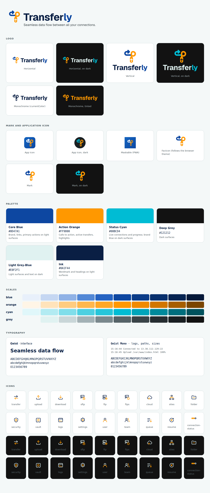

# Transferly brand

Visual identity for Transferly: logo, app icons, palette, typography and icons. Everything is SVG and generated by `scripts/build.py`; open [preview.html](preview.html) to see the whole kit.



## Logo

The mark joins a transfer arrow, which loops into the bar of a **T**, with an **f** whose stem carries an upload arrow.

| File | Use |
| --- | --- |
| `logo/logo-horizontal.svg` | Default logo on light surfaces |
| `logo/logo-horizontal-on-dark.svg` | Default logo on dark surfaces |
| `logo/logo-vertical.svg`, `logo/logo-vertical-on-dark.svg` | Square spaces: login, empty states |
| `logo/logo-tagline.svg` | With the tagline, for the README and the landing page |
| `logo/logo-mono.svg`, `logo/mark-mono.svg` | One color; they take `currentColor` |
| `logo/mark.svg`, `logo/mark-on-dark.svg` | The mark alone, for the top bar |

On dark surfaces Core Blue becomes Status Cyan. Keep a clear space of half the mark's height around the logo, and do not use the mark below 16 px.

## Application icon

| File | Use |
| --- | --- |
| `app-icon/favicon.svg` | Browser tab; switches to cyan in dark mode |
| `app-icon/app-icon.svg` | Rounded square, light |
| `app-icon/app-icon-dark.svg` | Circle, dark |
| `app-icon/app-icon-maskable.svg` | PWA maskable icon, full bleed with a safe zone |

## Palette

| Token | Value | Use |
| --- | --- | --- |
| Core Blue | `#0D47A1` | Brand, links, primary actions on light surfaces |
| Action Orange | `#FF9800` | Calls to action, active transfers, highlights |
| Status Cyan | `#00BCD4` | Live connections and progress; brand blue on dark |
| Deep Grey | `#121212` | Dark surfaces |
| Light Grey-Blue | `#E0F2F1` | Light surfaces and text on dark |
| Ink | `#0A1F44` | Wordmark and headings on light surfaces |

`tokens/colors.css` defines them as `--tf-*` variables with 50–900 scales; `tokens/tokens.json` holds the same values. Orange carries dark text (`#121212`), not white, to keep the contrast.

## Typography

Geist for the interface and the wordmark (Bold, tracking −2%), Geist Mono for logs, paths and sizes. Both already ship with the frontend.

## Icons

`icons/` holds 24 px icons with 1.75 strokes in `currentColor` and one accent per icon in `var(--tf-accent, #FF9800)`. They are drawn to sit next to Lucide, which the frontend uses.

## Rebuild

```sh
pip install fonttools brotli uharfbuzz
npm pack geist && tar xzf geist-*.tgz
python branding/scripts/build.py --fonts package/dist/fonts/geist-sans
```

The wordmark is converted to outlines, so the SVGs need no installed font.
